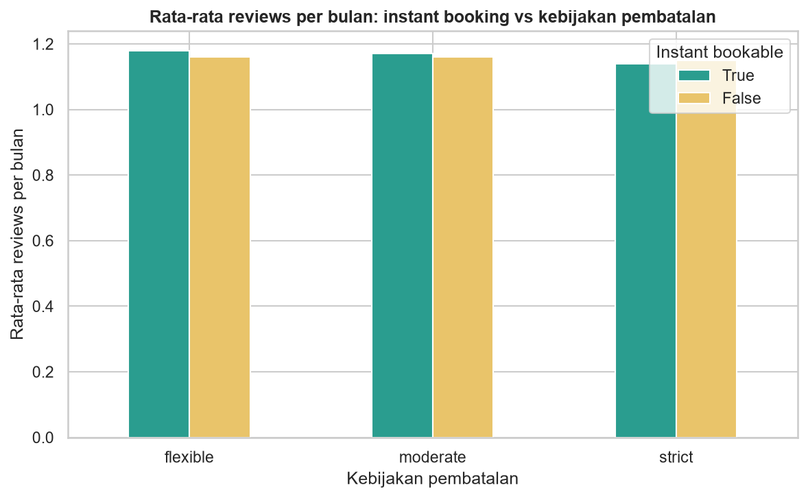
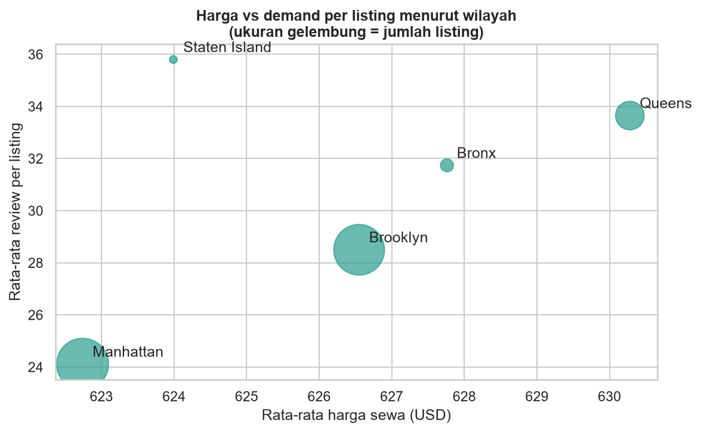
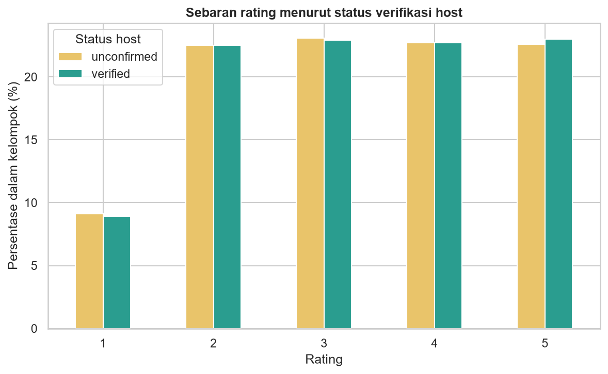
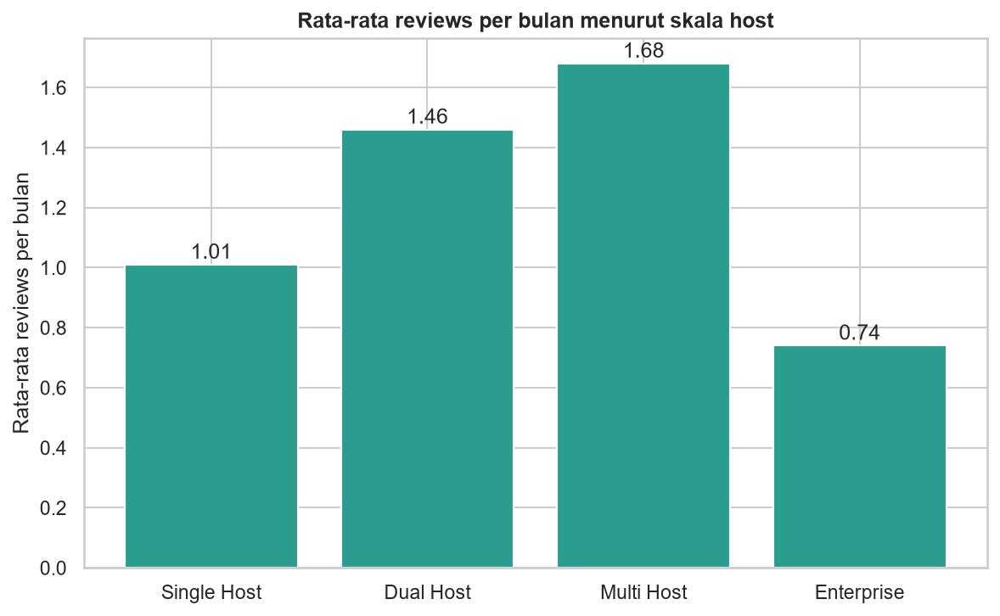
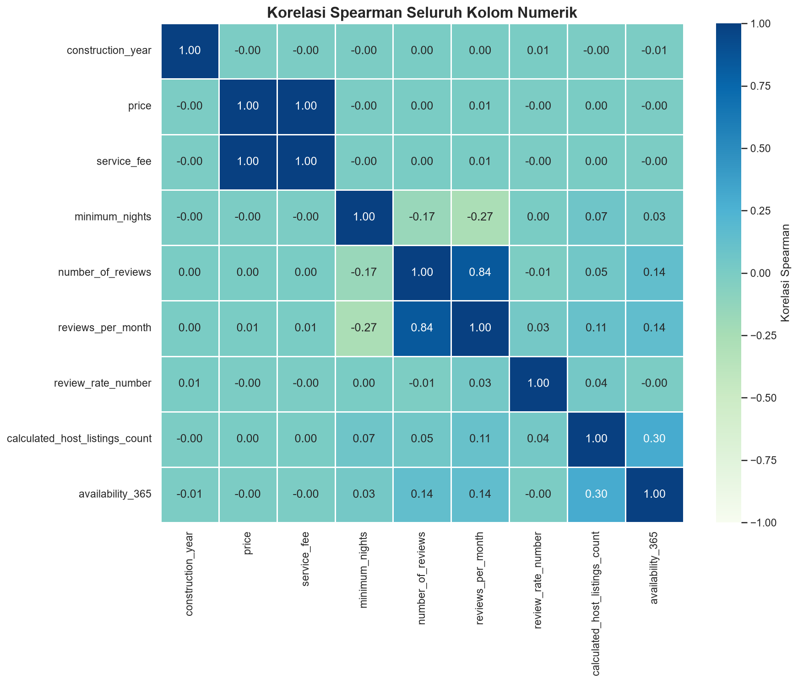
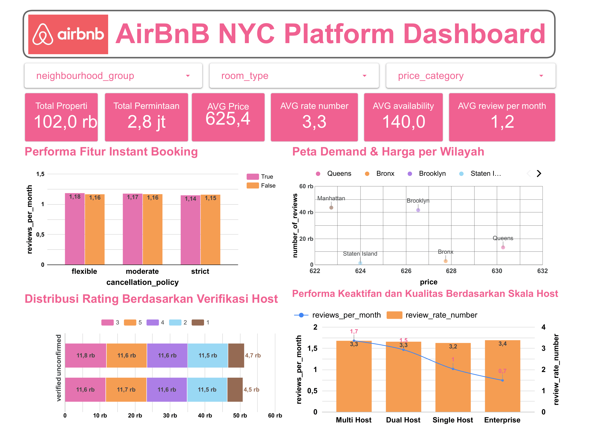

# Analisis Pricing, Demand, dan Performa Host Airbnb NYC

Proyek final bootcamp Data Analyst with SQL & Python: membersihkan data listing Airbnb New York, mengeksplorasi hubungan antar variabel, menjawab empat pertanyaan bisnis, lalu menyajikannya dalam dashboard Looker Studio.

> **Catatan:** temuan di bawah menggambarkan dataset ini, bukan kondisi Airbnb sebenarnya.

## Pertanyaan bisnis

1. Apakah instant booking dan kebijakan pembatalan yang fleksibel berkaitan dengan tingginya aktivitas review?
2. Bagaimana hubungan harga sewa dan demand di berbagai wilayah? Wilayah mana yang paling potensial untuk ekspansi host baru?
3. Faktor apa yang paling memengaruhi tingginya rating tamu? Apakah host terverifikasi mendapat rating lebih tinggi?
4. Apakah host dengan banyak properti punya rating dan aktivitas review yang lebih baik daripada host dengan satu properti?

## Dataset

- Sumber: [*Airbnb Open Data - New York City Listings (Kaggle)*](https://www.kaggle.com/datasets/ahmed1metawea/airbnb-open-data-new-york-city-listings-20192022?select=Airbnb_Open_Data.csv) Data mentah tidak disertakan di repo; unduh dan simpan sebagai `Airbnb_Open_Data.csv`.
- 102.599 baris dan 26 kolom (listing Airbnb di New York).
- Hasil akhir: `airbnb_cleaned_for_dashboard.csv` (102.045 baris, 30 kolom), dibuat oleh notebook 01.

## Alur kerja

| Tahap | Alat | Hasil |
|---|---|---|
| Data preparation | Python (pandas) | `01_airbnb_data_preparation.ipynb`, [cleaning log](docs/cleaning_log.md) |
| EDA dan analisis pertanyaan bisnis | Python (scipy, matplotlib, seaborn) | `02_airbnb_eda.ipynb`, `docs/img/` |
| Dashboard | Looker Studio | [Buka dashboard](https://datastudio.google.com/reporting/0ee48c18-5d5f-439f-877f-b9a6ce4eb1d8) |
| Presentasi | Google Slides | [`docs/presentasi.pdf`](docs/presentasi.pdf) |

## Temuan utama

**1. Instant booking tidak membedakan aktivitas review**

Selisih rata-rata review per bulan antara listing dengan dan tanpa instant booking hanya 0,01 sampai 0,02 pada semua kebijakan pembatalan (flexible 1,18 vs 1,16; moderate 1,17 vs 1,16; strict 1,14 vs 1,15). Instant booking dan kebijakan pembatalan juga tidak saling berkaitan (Cramér's V 0,01): sekitar sepertiga listing pada tiap kebijakan memakai instant booking.

**2. Jumlah listing bukan ukuran demand**

Harga rata-rata hampir sama di semua wilayah ($623 sampai $630). Manhattan (43.551 listing) dan Brooklyn (41.627) memiliki listing dan total review terbanyak, tetapi demand per listing justru terendah: 24,1 dan 28,5 review per listing. Queens (13.195 listing) memiliki harga tertinggi ($630) namun 33,6 review per listing dan 1,59 review per bulan, jauh di atas Manhattan (1,04). Wilayah dengan listing sedikit tetapi demand per listing tinggi (Queens, Bronx, Staten Island) adalah kandidat ekspansi host baru. Staten Island hanya 949 listing, jadi angkanya kurang stabil.

**3. Verifikasi host tidak berkaitan dengan rating**

Sebaran rating host terverifikasi dan belum terverifikasi hampir identik, dengan rata-rata 3,29 vs 3,27 (chi-square p = 0,290; Cramér's V = 0,003). Rating juga tidak berkorelasi dengan harga (Spearman 0,00).

**4. Host skala menengah paling aktif, host skala besar paling rendah**

Review per bulan: Single Host 1,01, Dual Host 1,46, Multi Host 1,68, Enterprise 0,74. Rating hampir sama di semua skala (3,24 sampai 3,37). Penurunan tajam hanya terjadi pada host Enterprise (lebih dari 10 listing).

**Temuan pendukung dari korelasi**

- `price` dan `service_fee` berkorelasi 1,00: biaya layanan adalah persentase tetap dari harga.
- `minimum_nights` berkorelasi negatif dengan `reviews_per_month` (-0,27): syarat menginap lebih lama membuat perputaran tamu lebih lambat.
- Host berskala besar memusatkan properti di area tertentu (correlation ratio `neighbourhood` dengan jumlah listing host 0,43) dan lebih sering membuka kalender hampir sepanjang tahun (`host_type` dengan `availability_365` 0,30).

## Dashboard

Dashboard Looker Studio merangkum KPI listing, sebaran harga, demand per wilayah, rating, dan performa host. [Buka dashboard](https://datastudio.google.com/reporting/0ee48c18-5d5f-439f-877f-b9a6ce4eb1d8).

## Rekomendasi

1. **Harga berbasis wilayah dan demand.** Kembangkan rekomendasi harga per wilayah dan tingkat demand; perbedaan harga antar wilayah sangat kecil, sementara demand per listing berbeda jauh.
2. **Insentif host di wilayah dengan demand tinggi dan listing sedikit.** Arahkan promosi dan perekrutan host baru ke Queens, Bronx, dan Staten Island.
3. **Jangan mengandalkan verifikasi sebagai indikator kualitas.** Status verifikasi tidak berkaitan dengan rating, jadi dorong faktor lain yang memengaruhi pengalaman tamu.
4. **Dukung host berskala besar.** Berikan alat pengelolaan listing bagi host Enterprise, yang aktivitas per listing-nya paling rendah.

## Ringkasan cleaning

102.599 baris menjadi 102.045: 541 duplikat dibuang dan 13 baris dengan `service_fee` tidak masuk akal dibuang. Kolom `license` (100% kosong) dibuang, nilai kosong lain diisi sesuai aturan per kolom, 3.185 nilai `availability_365` di luar 0-365 dan 13 nilai `minimum_nights` di bawah 1 dibatasi, dan lima kolom kategori ditambahkan. Outlier hanya dilaporkan, tidak dibuang. Detail ada di [docs/cleaning_log.md](docs/cleaning_log.md).

## Struktur repo

- `01_airbnb_data_preparation.ipynb`: mengenali data, membersihkan, menangani nilai tidak valid, membuat kolom baru
- `02_airbnb_eda.ipynb`: EDA, korelasi, dan jawaban pertanyaan bisnis
- `docs/`: cleaning log, tabel validitas dan outlier, presentasi, dan gambar
- `requirements.txt`: dependensi Python

## Cara menjalankan

1. Instal dependensi: `pip install -r requirements.txt`.
2. Unduh dataset dari Kaggle dan simpan sebagai `Airbnb_Open_Data.csv` di folder repo.
3. Jalankan `01_airbnb_data_preparation.ipynb` (menghasilkan `airbnb_cleaned_for_dashboard.csv`), lalu `02_airbnb_eda.ipynb`.

## Keterbatasan

- Jumlah review dipakai sebagai pendekatan untuk demand; data tidak memuat jumlah pemesanan sebenarnya.
- Analisis ini menunjukkan keterkaitan, bukan sebab-akibat.
- Harga rata-rata nyaris sama di semua wilayah dan distribusi harga hampir seragam, pola yang tidak lazim untuk pasar sewa nyata. Halaman Kaggle tidak menjelaskan bagaimana data ini dikumpulkan atau diolah, jadi hasilnya tidak diklaim mewakili kondisi Airbnb sebenarnya dan tidak dapat digeneralisasi.
- Nilai kosong pada `price`, `service_fee`, dan beberapa kolom angka lain diisi median; listing tanpa review diberi nilai 0, sehingga rata-rata review memasukkan listing yang belum punya review.
- Kolom `instant_bookable` dan `cancellation_policy` yang kosong dikelompokkan sebagai `Not Specified` dan tidak dimasukkan ke perbandingan.
- Staten Island dan Bronx hanya punya 949 dan 2.694 listing, jadi angkanya kurang stabil dibanding wilayah lain.
